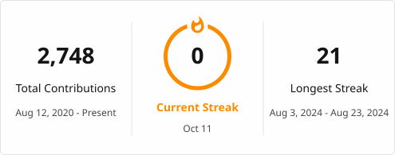

# Minda Huang

Student developer building projects across computer science and electrical engineering.

  
  

## Tech Stack

**Languages:** `C++` · `Python` · `Java` · `C#`  
**Frameworks & Platforms:** `Qt` · `WPILib` · `Unity` · `Arduino`  
**Engineering & Design:** `JLCEDA` · `Onshape`

Additional Tools

- **Video & Audio:** Premiere Pro · DaVinci Resolve · Audition
- **Broadcast & AV:** OBS · ATEM
- **Graphic Design & Photography:** Photoshop · Illustrator · Lightroom Classic

## Selected Projects

- [**RMYC-yolo**](https://github.com/hs150521/RMYC-yolo) — Automatic aiming system developed for the RoboMaster Youth Championship (RMYC).
- [**Skin Disease Detector**](https://github.com/hs150521/skinDiseaseDetectorBackEnd) — CTB team project; responsible for model training and backend development.
- **Multiplexer Controller** — Qt and Modbus-based automated testing software developed during an internship.
- [**BreathSea**](https://github.com/hs150521/BreathSea) — Breath-responsive interactive artwork.

## Award-winning Hackathon Projects

- [**爱搞机鸭**](https://gallery.adventure-x.cn/projects/cms0k6bhe001p02jvziv4v67b) — Desktop AI companion integrating physical sensing and digital agents. Embedded developer; second prize.
- [**Silent Speak**](https://gallery.adventure-x.cn/projects/2500d2b4-87f2-43a3-89fa-a14aa05e9ea9?event=advx-2025) — Lip-reading communication prototype for AR glasses. Embedded systems and networking; second prize.

## Experience

- Lead programmer and competition engineer with [FRC Team 6941 IronPulse](https://github.com/frc6941).
- Programming mentor for [FTC Team 30319 LithiumPulse](https://github.com/frc6941/2026-ftc-robot).

  

